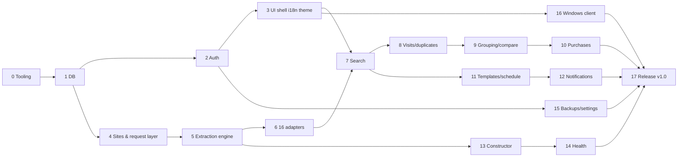

# PriceLens — Implementation Plan

Goal: a working product — Docker server (PostgreSQL + API + worker + web), Web UI and Windows (Tauri) client, **all 16 sites** searchable, UI in **EN / RU / UK** with language switcher and **light/dark theme**.

Source of truth: `docs/` (requirement IDs `FR-*`), `AGENTS.md`. Every stage references the IDs it implements.

## Global rules

1. **Test gate after every stage.** A stage is done only when its tests are written and green; the next stage does not start before that.
2. Test pyramid per stage: unit (Vitest) → integration (real Postgres via Docker / Testcontainers) → e2e (Playwright) where UI exists.
3. Each stage ends with: spec status updated (`Draft → Implemented`), changelog entry, `docker compose up` still works, all previous tests still pass (regression).
4. Commits: Conventional Commits with requirement IDs. One stage = one branch/PR.
5. Coverage target: shared/domain logic ≥ 90%, API services ≥ 80%, adapters: contract + snapshot test for each of 16 sites.
6. Circuit breaker from `AGENTS.md` applies.

Legend per stage: **Scope · Tasks · Tests · Exit criteria**.

---

## Stage 0 — Repository & tooling

**Scope:** monorepo skeleton (`docs/00-rules.md`, ADR-0004).

**Tasks**
1. `pnpm` workspaces + Turborepo; packages: `apps/api`, `apps/worker`, `apps/web`, `apps/desktop`, `packages/shared`, `packages/db`, `packages/adapters`.
2. TypeScript strict base config, ESLint + Prettier, EditorConfig (UTF-8).
3. Vitest workspace config; Playwright config; Testcontainers helper for Postgres.
4. `docker-compose.yml` (postgres 16 with `pg_trgm`, api, worker, web), `.env.example`.
5. GitHub Actions (or local `pnpm ci` script): install → typecheck → unit → integration.
6. Husky + commitlint (Conventional Commits).

**Tests**
- Smoke unit test in each package.
- CI script runs green; `docker compose up` starts all containers, healthchecks pass.

**Exit:** `pnpm ci` green, `docker compose up` → `GET /health` = 200.

---

## Stage 1 — Database & migrations

**Scope:** `docs/04-data-model.md`.

**Tasks**
1. Prisma schema for all tables: users, sites, site_groups, site_config_versions, site_health, user_site_selection, searches, search_templates, template_schedules, schedule_runs, listings, listing_prices, products, product_listings, search_results, visits, listing_marks, duplicates, purchases, notifications, telegram_links, settings, audit_log.
2. Initial migration + `pg_trgm` extension + indexes (url unique, trigram on titles, FK indexes).
3. Seed script: super-admin (from env), default settings, 16 site records (disabled until adapters exist).

**Tests**
- Integration: migrate up on clean DB; seed idempotent (run twice).
- Constraint tests: unique URL, FK cascades, enum values.

**Exit:** fresh DB migrates + seeds in CI.

---

## Stage 2 — Auth, users, roles (FR-ADM-001, 05-security)

**Tasks**
1. NestJS auth module: login (Argon2), session tokens (hashed, expiry), logout, `me`.
2. Guards: `AuthGuard`, `AdminGuard`; stable `{ error: "snake_code" }` errors.
3. Users admin API: create user/admin, set/reset password, change role, deactivate.
4. Audit log for admin actions (FR-ADM-003).
5. First-run: if no users, create super-admin from env.

**Tests**
- Unit: password hashing, token expiry.
- Integration: login ok/fail, deactivated user blocked, user cannot call admin routes (403), admin can create admin, audit entries written.

**Exit:** auth matrix test (role × endpoint) green.

---

## Stage 3 — Web UI shell, i18n, themes (FR-UI-001/002)

**Tasks**
1. React + Vite + TypeScript app; router; API client `src/lib/api.ts`.
2. i18n in `packages/shared/src/i18n/{en,ru,uk}.json`; language switcher in header; persisted per user (server) and locally before login. **Default: English.**
3. Theme tokens (CSS variables), light/dark switch, persisted per user; respects OS preference on first run.
4. Login page, layout (header, left panel, content), user menu, admin section skeleton.
5. Admin UI: users list / create / edit / role / deactivate.

**Tests**
- Unit: i18n key parity test — every key exists in en/ru/uk (fails CI on missing key).
- Unit: no hardcoded strings lint rule (custom ESLint rule or check).
- E2E: login → switch EN→RU→UK → texts change; dark theme toggles and persists after reload; user without admin role cannot see admin menu.

**Exit:** e2e green in Chromium; screenshots light/dark × 3 languages stored as artifacts.

---

## Stage 4 — Site registry & request layer (FR-SITE-001..005, FR-SCH-004/005/006)

**Tasks**
1. Sites CRUD API + admin UI (name, domain, mode, URL template, enabled, priority, region tags, poll interval, max concurrency).
2. Site groups / presets.
3. Shared request layer in worker: per-site rate limiter, max concurrency, randomised delay, retry with backoff on 429/captcha, auto-pause + admin notification, proxy hook interface (no implementation).
4. Playwright browser pool in worker container (headless Chromium), plus plain HTTP fetch path for JSON/HTML sites.
5. Site config versioning (history, rollback), JSON export/import.

**Tests**
- Unit: rate limiter honours interval/concurrency; backoff schedule.
- Integration: CRUD + versioning + rollback; import/export round-trip.
- E2E: admin creates, edits, disables, deletes a site.

**Exit:** request layer verified with a local mock HTTP server (fake 429 / captcha responses).

---

## Stage 5 — Extraction engine (ADR-0002, FR-CON-006/007)

**Tasks**
1. `packages/adapters/engine`: field definitions (title, price, currency, url, image, location, posted_at, description, specs).
2. Strategy chain per field: JSON-LD/schema.org/OpenGraph/microdata → semantic anchors (label text, ARIA, data-*) → content patterns (price regex, URL type) → relative position inside repeated card → CSS/XPath fallback.
3. Repeated-card detection (find repeating sibling blocks containing price + link).
4. Value validators & normalisers (price "12 000 грн" → 12000 UAH, dates "Сьогодні 17:43" → timestamp in Europe/Kiev).
5. Self-healing: on failure, relocate by stored sample values/text features, produce proposal diff.

**Tests**
- Unit: each strategy on fixture HTML; normalisers (UAH/USD formats, uk/ru date words).
- **Resilience tests:** same fixture with renamed classes/tags/ids → extraction still succeeds.
- Self-healing test: broken selector → proposal generated with correct new strategy.

**Exit:** ≥ 95% field accuracy on fixture suite.

---

## Stage 6 — Built-in adapters for all 16 sites (FR-SITE-010, FR-REL, ADR-0005)

Sites: OLX, Prom.ua, Bigl.ua, Hotline.ua, Rozetka, EK.ua, kvshop.com.ua, itbox.ua, click.ua, brain.com.ua, touch.com.ua, skay.ua, pcshop.ua, f.ua, proton-it.kyiv.ua, tex.ua.

**Tasks (per site, repeated 16×)**
1. Investigate native search: URL template / API, params for query, price min/max, condition, city, page, sort.
2. Implement adapter config (search URL + extraction strategies) using engine; Playwright only when page requires JS.
3. Map native filters; document unsupported filters (filtered client-side).
4. Save HTML/JSON snapshots of results page (FR-REL-005).
5. Google fallback provider (`GoogleFallbackProvider`) for any site where native search is unusable (ADR-0001), key optional.

Suggested batches: A) OLX, Prom, Bigl, Hotline · B) Rozetka, EK, Brain, Click · C) itbox, kvshop, touch, skay · D) pcshop, f.ua, proton-it, tex.ua.

**Tests**
- Offline snapshot test per site: ≥ 10 results with valid title/price/url.
- Live contract test per site (`pnpm test:live`, nightly / manual): query "ноутбук" returns ≥ 1 valid result.
- Filter tests: price range respected in returned items.

**Exit:** 16/16 snapshot tests green; 16/16 live contract tests green at least once (results recorded in `docs/site-status.md`).

---

## Stage 7 — Multi-site search (FR-SRCH-001..005, FR-SITE-011)

**Tasks**
1. Search API: query + filters + site_ids → job fan-out per site via pg-boss; results streamed (SSE/WebSocket) as each site finishes.
2. Persist searches, listings (upsert by URL/external id), listing_prices, search_results.
3. Cache by (site, normalised query, filters) honouring poll interval.
4. Partial results: failed sites reported with reason (FR-REL-004).
5. UI: search bar, left panel with site checkboxes + groups (select all/none/invert), filters (price, condition, city, date), selection saved per user.
6. Results table (FR-UI-004): sortable/filterable columns, column chooser, thumbnails, open link (records visit).
7. Search history.

**Tests**
- Integration: fan-out with mocked adapters (one slow, one failing) → partial results + error list; cache hit avoids second request.
- Unit: listing upsert & price history entry on price change.
- E2E: select 3 sites → search → results appear progressively; unchecked sites not queried; checkbox state restored after re-login.
- Performance: 16 sites mocked, results < 10 s.

**Exit:** real search across 16 sites from UI works on the dev stack.

---

## Stage 8 — Visits, marks, duplicates (FR-VIS-001..006, FR-UI-005)

**Tasks**
1. Visit recording when opening link via app (who/when), shared across team.
2. Badges: visited ("Opened by X, date"), dimmed rows, "hide visited" filter.
3. Statuses: Interesting / Rejected / Bought / Contacted; notes private or shared; tags.
4. Duplicate detection: same URL, same external id, re-post similarity (title trigram + price + image hash) → marked duplicate of original.
5. Price-change badge on known listings.
6. Keyboard shortcuts V / I / R / B / Enter / Ctrl+Click / `/`.

**Tests**
- Unit: duplicate scoring (positive/negative fixtures).
- Integration: user A visits → user B sees badge; private note invisible to B.
- E2E: shortcuts change status; hide-visited works; re-run search shows visited markers.

---

## Stage 9 — Product grouping & comparison (FR-GRP, FR-CMP)

**Tasks**
1. Spec extraction for laptops: brand, model, CPU, RAM, storage, GPU, screen (regex + dictionaries), editable manually.
2. Model normalisation & fuzzy matching (pg_trgm + rules) → product groups with confidence.
3. Manual merge/split/move; manual decisions persisted and override auto.
4. Group view: new price range (shops) vs used price range (classifieds).
5. Compare drawer: side-by-side table of selected items (price, specs, seller, condition, site, link).
6. Price analytics: min/avg/median/max, distribution, price history chart.
7. Deal score + expected profit (FR-CMP-006), thresholds and min margin in settings.
8. Export CSV/XLSX (FR-CMP-007).

**Tests**
- Unit: spec extractor on 200+ real titles fixture (accuracy ≥ 90%); deal score edge cases (< 3 samples → insufficient data).
- Integration: grouping of mixed shop + OLX fixtures; manual merge survives re-grouping.
- E2E: select 3 rows → compare drawer; export downloads valid file.

---

## Stage 10 — Purchases (FR-BUY)

**Tasks**
1. "Bought" form: price (prefilled), date, qty, note; snapshot of listing.
2. Badge "Bought before: N×, last price/date" on matching group and listings.
3. Group panel purchase history + chart overlay; hint "cheaper than last purchase by X".
4. Optional sale price/date → realised margin.
5. Purchases page with filters, totals, export.

**Tests**
- Integration: purchase → later search for same model shows badge and hint.
- Unit: margin calculations.
- E2E: mark bought via shortcut B → form → badge visible.

---

## Stage 11 — Search templates & scheduling (FR-TPL, FR-SCH)

**Tasks**
1. Templates CRUD: name, query, sites, filters, sort; duplicate; personal/shared.
2. One-click run; edit query/sites later.
3. Schedules: interval / daily time / cron; pause/resume; per-site interval floor respected.
4. "Only new since last run" + price drops; run history (new/changed/errors).
5. Missed runs (laptop off) executed once on startup.

**Tests**
- Unit: schedule calculation, interval floor.
- Integration: scheduled run returns only unseen items; missed-run catch-up.
- E2E: create template → edit sites → run → schedule.

---

## Stage 12 — Notifications (FR-NTF)

**Tasks**
1. In-app notification centre (unread count, list, mark read) via WebSocket/SSE.
2. Telegram bot: link account by one-time code; messages with title, price, site, city, deal score, link; inline buttons Interesting/Reject updating shared status.
3. Rules per template: only new, price drop, deal threshold, quiet hours.
4. Admin alerts: site broken (FR-REL-003), backup failure.

**Tests**
- Unit: rule evaluation, quiet hours.
- Integration: mocked Telegram API — message payload, button callback updates status.
- E2E: in-app notification appears after scheduled run.

---

## Stage 13 — Visual site constructor (FR-CON-001..009)

**Tasks**
1. Wizard: name, domain, test search → detect query parameter from pasted URL.
2. Embedded browser view: web — server-side Playwright streamed screenshots with click mapping; desktop (Tauri) — WebView with injected picker script.
3. Click picker: result card, then title/price/description/image/link/location/date; captures multi-strategy descriptors (not just CSS).
4. Pagination detection; optional detail-page mapping.
5. Live preview table; save as versioned config; health check scheduled.
6. Self-healing proposals UI with one-click approve.

**Tests**
- Integration: constructor on local fixture site → saved config extracts correctly.
- Resilience: rename classes on fixture site → extraction still correct.
- E2E: full wizard flow on fixture site creates working site that appears in search checkboxes.

---

## Stage 14 — Site health & reliability dashboard (FR-REL, FR-CON-008)

**Tasks**
1. Scheduled health checks for all sites; status green/yellow/red, success rate 7d, avg latency, last error + screenshot.
2. Auto Google fallback for red sites where configured.
3. Dashboard page in admin.

**Tests**
- Integration: simulated failures change status and trigger alert once (no spam).
- E2E: dashboard shows 16 sites with status.

---

## Stage 15 — Backups & settings (FR-ADM-002/004, ADR-0006)

**Tasks**
1. Global settings UI: API keys, thresholds, min margin, costs, default language/theme, backup schedule & count.
2. Backups: scheduled `pg_dump` (default 03:00), manual backup, rotation keep 10, list, download, delete, upload, restore (confirmation + safety backup first), catch-up after downtime.

**Tests**
- Integration: 12 backups → only 10 remain; restore returns DB to prior state; safety backup created; uploaded file validated.
- E2E: admin downloads and deletes backup; user role has no access.

---

## Stage 16 — Windows desktop client (ADR-0003)

**Tasks**
1. Tauri app wrapping web UI; server address setting (+ optional LAN discovery).
2. Tray icon, native notifications, "Open in browser" action, auto-update optional.
3. Constructor picker integration via WebView.
4. Windows installer (MSI/NSIS) build script.

**Tests**
- Smoke e2e (WebdriverIO/tauri-driver): launch → connect to server → login → search → switch language/theme.
- Manual checklist on Windows 10/11.

---

## Stage 17 — Hardening & release v1.0

**Tasks**
1. Security review: auth on every route, rate limit on login, headers, LAN-only defaults, secrets in `.env`.
2. Performance: 16-site search < 10 s, results table 5 000 rows smooth (virtualised).
3. Docker Desktop autostart guide, firewall rule, fixed IP doc (`docs/OPS.md`).
4. User guide (EN/RU/UK) in `docs/user-guide/`.
5. Full regression: `pnpm ci:full` + live contract tests for 16 sites.

**Exit criteria — v1.0 "working product"**
- [ ] `docker compose up` on owner's laptop; LAN clients connect via browser and Windows app.
- [ ] Search across **all 16 sites** with native search (Google fallback only where needed), partial results on failure.
- [ ] UI switches **EN / RU / UK**; **dark/light theme**; both persist per user.
- [ ] Admin/user roles, user management.
- [ ] Templates, schedules, Telegram + in-app notifications.
- [ ] Visits/duplicates/statuses shared; grouping, comparison, deal score, purchases history.
- [ ] Visual constructor creates a working new site.
- [ ] Health dashboard; backups (10 rotation, restore/download/delete).
- [ ] All unit/integration/e2e tests green; 16/16 live contract tests green.

---

## Stage dependency overview

